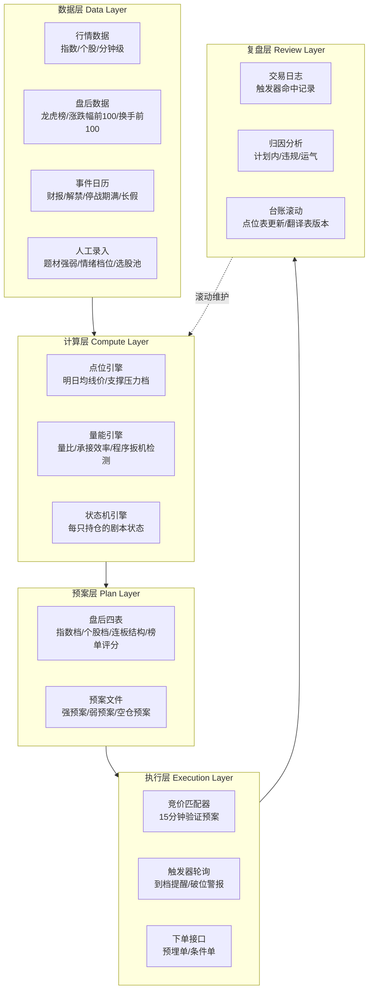

**量能判断真假 → 先手买法控制进场成本 → 做T让持仓增值**。下面按他原文的颗粒度逐个拆。

#### **一、先手买法：用明天的均线，倒推今天的买点**

这套东西解决的是超短选手最常见的死法——“回踩均线低吸，结果吸在破位上”。他自己给出的病灶诊断是：如果等股价回踩5日线再买，等那一天真到来时，往往是放量跌破5日线、日内直接大亏。所以他的解法是**把均线当成可以计算的未来坐标，提前一天埋伏**：今天的5日线是25.5，根据均线上移规律可以推算明天的5日线在26.5附近，那么今天尾盘26.5就是买点——这样到了明天，跌破了5日线止损（亏得极小），拉升了止盈（赚得从容），两头都不被动。[周末饭堂](https://www.dongge.blog/post/168)

他在那篇帖子里给了三个教科书案例，覆盖了三种变形：

| 案例 | 模式 | 关键条件 |
|---|---|---|
| 川环科技 | 5日先手+一字首开 | 热门题材、市值低、PE低，一字板首开当天“竞价不高且放量，直接介入”，之后用均线上移买法滚动 |
| 博创科技 | 10日先手 | 1.3日的10日线41.59，推算1.6日约42.3，今天43附近先手，周一跌破10日止损、拉升止盈 |
| 兆龙互连 | 5日线下移买法 | 5日线明天将下移到60.5，今天尾盘拉升突破60.5就是买点，周一按能否站稳5日决定去留 |

三个案例共享同一套前提筛选：**必须是热门题材**（有人气、有资金、有上窜下跳的空间），先手买法本身只是择时工具，题材强度才是地基——他在[题材股的A杀](https://xueqiu.com/3922959557/391930996)里明确说，教先手买法的目的“就是为了避免深套”。

和先手买法配套的是一套分级止损规则。粉丝问他一只票做到什么时候结束，他的回答精确到利润厚度：“**利润厚我会放宽到10日，利润不够5日我就做决断**。”而底层铁律来自A杀那篇：千万不要持仓等均线——“破5日就是卖点，到10日再买，再破再卖，到20日再买”，均线永远只做买点和风控线，绝不做扛单的理由。执行层面还有两个细节：一是“我从不竞价直接摁”——竞价直接按卖出是大忌，“你但凡多等一秒就能看到他冲高6%”；二是他的入场模式不止先手一种，二进三打板（“既有金融属性也有消费属性，性价比合适”）、首板分时低吸、新股模式都在他的武器库里，但他自认“80%的交易是无效的，让账户腾飞的只有那20%”。

#### **二、五类做T：三种正T、两种反T**

[做T的心得](https://www.dongge.blog/post/175)是他体系里写得最工程化的一篇。先划适用边界：**做T只能用在中线趋势个股上，超短连板慎用**——“超短连板情绪化偏多，很难通过点位来把握趋势”；对波动极大的妖股他更直接：“优刻得、并行、青云这类股偶尔一两次可以，但尽量不要做T，波动太大。”

动手前有四个前置条件。一是**题材强度**：确保个股在热门题材里，有人气有资金有上窜下跳的空间，“选股审美是个很重要的基本功”。二是**认知**：买之前问自己为什么参与、这是什么级别的题材——“核心题材在结束前，任何一次盘中下跌都是买点”，分不清超级题材和过渡题材，做T就是逆水行舟。三是**心态**：他给了一个扎心的观察——“80%的人连自己为什么买这个股都不清楚”，跌了不敢买、涨了慌着卖都是低级错误。四是**纪律**：支撑压力的用法随周期切换——**上升期，支撑位对应买点、压力位对应卖点；下降周期，支撑位是用来做风控的，跌破支撑反而是卖点而不是买点**。

然后是五类做T的正菜：

**三种正T（先买后卖，收盘必须还原仓位）**：

1. **正常低吸高抛**——同等仓位盘中低点买、拉升途中卖，仓位不变。
2. **加仓低吸高抛**——前一日10%仓位，次日跌到支撑位买入20%，拉升卖掉10%。适用场景：“你对个股有很强的看好预期，或者说加仓买入的当日有很好的套利预期。”
3. **减仓低吸高抛**——前一日10%仓位，次日支撑位只买5%。适用场景：“你虽然看好，但没把握今天能拉升，没把握支撑能撑住，存在跌破风险——如果跌破，需要立马卖出原本10%的持仓。”

这三种的差别本质是**信心分级决定下单比例**，而他反复强调的收口铁律是：“**做正T无论做成功与否，收盘前需要保持跟开盘前一样的仓位，切记不能做T做成了加仓**。”评论区里“做T变成加仓然后高位站岗”是出现频率最高的惨案，他的回应永远只有两个字：“纪律啊。”并补刀：“下降周期这种操作要老命。”

**两种反T（先卖后买）**：

4. **全仓高抛低吸**——个股极致拉升、涨幅过大、分时买盘衰竭或买盘后劲无力时，可以全部清仓，等回落到某个位置再分批低吸接回。
5. **半仓高抛低吸**——拉升到压力位，没把握能否冲过去，先卖一半，剩下一半盘中纠错。

效果他用实盘换算过：润欣科技12月16日26元介入、12月30日28元离场，区间涨幅只有8%，靠波段做T做出了接近60%的利润；高新发展9月13日39元介入、10月25日71元离场，区间涨幅82%，做T做出了接近200%。这就是他“慢就是快”同行的复利引擎——不靠选到十倍股，靠把一段20%的波段磨成翻倍。执行细节上他极其简化：“我一般计算好点位就记住了，不会再额外看分钟的分时”——点位提前算好，盘中只执行不分析。最后落在时代判断上：“未来一定是量化时代，人的操作永远比不过量化机器人，个股波动肯定会加剧，要想不被量化收割，只能模仿量化的手法来减少损耗。你不进步，那就是退步。”

#### **三、量能：所有判断的最终裁判**

他在[人性与交易](https://www.dongge.blog/post/138)里的总纲只有一句话：“**尊重成交量，尊重K线，尊重情绪。当盘面出现负反馈时，一定要果断。**”但展开后有一套相当完整的量能分析框架，散落在他的正文和答疑里。

**第一层：破位有效性的三问。** 粉丝问“上午10点跌破设定的X日线，是即刻止损还是等收盘”，他的回答是破位不能机械处理，要看三件事：“看怎么跌破的啊，是放量还是缩量？是主动跌破还是被指数、被板块带崩？看跌破后有无反抽止损位，能否再站回去。没有固定的说法。”延伸到压力位同样适用：“等跌破，看是否有反抽50，反抽不过去，那50大概率是有效跌破；如果跌破50连反抽都没有，那就看自己的利润或者纪律。”而止损位的设定他给了成长路径：“先把止损位简单放在固定的均线上（后面有能力再提高到支撑压力点位上）”——先机械后艺术。

**第二层：盘中破位与收盘确认的取舍。** 针对那种“盘中破位割了、下午又拉回来站上、目送大涨”的经典两难，他的答案意外地简单：“**那你就看收盘呗，不看盘中。**”——这句话和他自己“从不竞价直接摁”是同一个思想：盘中噪音交给纪律过滤，日线级别的事收盘再定。

**第三层：放量下跌看什么、和谁比。** 被追问“盘中放量下跌到底怎么判断，是看量比还是大单砸盘”时，他的回答朴素到离谱：“**成交量啊。**”再问和什么对比：“**都要对比。如果是热门股的话，还要对比前一段时间某个阶段的成交量，要做到心中有数。**”——即量能没有绝对阈值，只有相对结构：和自己昨天比、和当天盘内其他时段比、和这轮行情的前期阶段比。拉升放巨量呢？他的定性是“**进入题材炒作期啊**”——巨量阳线不是顶部信号，而是题材正式开炒的宣言。

**第四层：缩量与拥挤。** 上升趋势里的缩量他反而视为好事，原话出自[经得起风浪的才能穿越](https://www.dongge.blog/post/33)：“筹码断层，找不到支撑位，成交量缩量，新高也无压力，一切看板块指数跟情绪”——没有套牢盘的缩量新高是轻装上阵。另一端是拥挤度：有人问他“DeepSeek成交量占全市场25%，是不是太拥挤了”，他直接确认“**第一个对的**”——单一题材吞噬全市场四分之一的成交，就是他定义的危险信号。市场级别上他同样用量能定生死：“9000亿，这个量很低了，构架不起目前的指数行情，在行情回暖前一旦撤梯子，后果不堪设想”（[背离](https://www.dongge.blog/post/143)），而“久违的1.3万亿”本身就是他一篇复盘的标题（[原帖](https://www.dongge.blog/post/218)）。

**第五层：竞价量能与龙虎榜。** 他的先手条件里“竞价不高且放量”是硬性一项；反过来，4月24日某票跌停当天，他的复盘全部是量能+筹码语言：“昨天的榜太烂了，前天几个砸盘王锁仓，昨天又来了两亿砸盘王，竞价给红开就撤了；如果竞价能先被核，再走个弱转强还能多看一眼，结果竞价直接强转弱”（[4.24午复盘](https://www.dongge.blog/post/571)）——龙虎榜的砸盘结构决定他敢不敢留，竞价的量价形态决定他几分钟内的生死决策。

#### **三者的关系与局限**

拼起来看，这套体系的美感在于分工明确：**量能负责回答“真的还是假的”（破位真破假破、放量是炒作开始还是出货、拥挤是否到极限），先手买法负责回答“在哪进场成本最低”（明天均线的今天价格），做T负责回答“持仓期间怎么增值”（三种正T对应三级信心、两种反T对应两级风险）**——而贯穿一切的地基只有一条：题材必须是热门题材，纪律必须压过情绪。他给粉丝的终极检验方法也很实用：“去回测自己亏损最大的交易，如果每次都按均线止损，是卖飞多还是亏损变多？”


#### **一、总体架构：五层流水线**



#### **二、数据层：先把他的"每日梳理"变成采集任务**

他的风控基础是那句"每天梳理涨幅、跌幅、成交、换手前100，热门板块全部梳理一遍，龙虎榜看一遍"——这在工程上就是一组**定时爬取+落库**的ETL任务。数据源可以来自公开行情接口（Tushare、AKShare、同花顺/东财的数据导出），每晚收盘后自动拉取：指数与持仓股的日线和分钟线、涨跌幅/成交额/换手率四个榜单的前100名、当日龙虎榜、涨停板梯队结构（几板、封单额、炸板率）。

事件日历需要单独维护一张表：财报披露日（他的"鸡哥财报节点"）、指数ETF期权交割、长假前交易日、他自己关注的外部变量（美股期货、达子财报）。这张表是他"时间编码"的来源，财报末日和周五剧本都是从这里查出来的。

最需要设计的是**人工录入接口**：每天盘后用5分钟填写三个主观字段——今日题材强弱排序（最多三个主线）、情绪档位（热/温/冷）、明日候选股池（通常3-5只）。这一层承认"选股是人工的"，但把它变成结构化输入，后面的引擎才有东西可算。

#### **三、计算层：三个引擎对应他的三本词典**

**点位引擎**是整个系统的核心，实现他的"价格台账"。每晚对持仓池每只股票计算：

1. **明日均线价**：按先手公式 $\text{MA}_{N}^{明日} = \frac{\sum_{i=1}^{N-1} C_i + C_{预估}}{N}$ 滚动计算5日、10日、20日的明日位置，其中预估收盘价给三档（平开/高开2%/低开2%），输出是一个区间而非单点——这就是他"明天5日上移到111-112附近"的工程化版本。
2. **多档支撑压力**：按区间格式输出，如"57-58第一支撑（止损档）""91、95分批加仓档"，每档强制绑定一个动作字段（buy/add/trim/stop/observe），不允许存在没有动作的点位。
3. **失效标注**：检测筹码断层（近期无密集成交区覆盖）时，把该股的点位表标记为"失效，看板块指数与情绪"，对应他"找不到支撑位"的情况。

**量能引擎**负责翻译表。核心指标包括：竞价量比与昨日对比、开盘15分钟成交量占昨日全日比例、成交额效率比（他那句"百亿成交量可以拉3个20cm涨停"的量化：成交额/涨幅弹性）。特别要实现**程序扳机检测器**：指数放量跳水破5日、高开幅度超过阈值、跌破30日线这三个事件一旦发生，立刻推送警报——这些是他确认过的量化行为指纹，检测逻辑是确定性的，完全适合代码。

**状态机引擎**给每只持仓维护一个状态：`进场模式（立志/套利/确认）→ 持有中 → 触发器待命中 → 出场`。每个状态挂着自己的规则集——比如"套利模式"的票自动加载"两天10%止盈、冲高到压力档卖、持有不超过3天"这组规则，"先手买入"的票自动加载"明日均线破位清仓"。他那句"高位买的一律当成轮动套利"就是状态机初始化时的一个分支判断：根据买入位置在趋势中的坐标，决定加载哪套规则。

#### **四、预案层与执行层：把"盘中零计算"变成系统强制**

每晚21点前，系统应该生成一份**预案文件**，格式可以非常朴素——一张Markdown表：

| 持仓 | 状态/剧本 | 明日关键档位 | 触发动作 | 失效条件 |
|---|---|---|---|---|
| 短线A（套利） | 持有第2天 | 压力72-72.5 / 5日线预估69.8 | 冲压力卖；破69.8清 | 板块负反馈 |
| 中线B | 事件日历：长鑫上市前减仓 | 91 / 95 | 到档各加一档 | 破88无条件撤 |
| 候选C（新股） | 观察 | 竞价换手>阈值且竞价涨幅<5% | 满足才进，否则放弃 | 模式外不做 |

这份文件就是他自己说的"我一般计算好点位就记住了"的外置版本。**执行层的关键设计是"系统强制"而非"系统建议"**：竞价阶段（9:15-9:25）运行匹配器，输出三选一——强预案/弱预案/空仓预案；开盘后触发器轮询每30秒扫一遍持仓价格与台账档位，到档弹窗并要求一次人工确认；破位类触发器（止损档、明日均线）升级为最高优先级警报。

这里要专门实现他的两条铁律作为系统级约束：**做T收盘必须恢复原仓位**（收盘前30分钟检查，仓位不匹配则警报）和**破位T变减仓**（破位状态下的做T回补比例强制打折，对应他"破位剩下的今天不会回补"）。这两条用代码强制，比靠自觉可靠得多——他自己都会在情绪里违规（3月3日"没尊重量化"那天-7%），这正是工程化要消灭的失效模式。

#### **五、复盘层：归因比盈亏重要**

每天收盘回写一份交易日志，每条记录必须标注四个字段：触发器类型（哪个规则导致这笔交易）、是否在预案内、执行偏差（计划价vs实际价）、结果归因（计划内正确/计划内错误/违规/运气）。他那句"运气占据了5成"在工程上的对应物就是：**把运气从收益里剥离出去**。月度归因报告只看两个指标——预案执行率（低于85%说明纪律在崩）和计划内交易胜率（这个才是策略的真实水平，违规交易的盈亏不计入策略评估）。

翻译表要有**版本管理**。他把"缩量新高"在涨势里读作减仓警报、跌势里读作吸筹证据，说明信号翻译依赖市场状态——工程上就把翻译表做成`{市场状态 → 信号 → 含义}`的三元组配置，每季度或市场结构变化时（比如量化占比变化、监管规则变化）review一次版本，过期的规则标记deprecated而不是悄悄失效。


# 开发任务书：交易决策支持系统

## 0. 给编程Agent的总指令

你要构建一个**交易决策支持系统**，不是自动交易机器人。系统不连接任何交易接口，不下单。系统的职责是：维护点位数据表、按规则生成预案、盘中监控到档信号、推送给人确认、收盘后归因统计。所有买卖动作由人类在系统外执行。


## 1. 项目结构

```
pointtable/
├── README.md
├── requirements.txt
├── config.yaml                  # 数据源token、通知webhook、阈值参数
├── pointtable/
│   ├── __init__.py
│   ├── db.py                    # SQLAlchemy引擎与session
│   ├── models.py                # 三张核心表（见§2）
│   ├── schemas.py               # Pydantic模型：PointEntry、Signal、Plan
│   ├── calendar_cn.py           # 交易日历：是否交易日、是否周五、距长假天数
│   ├── datafeed/
│   │   ├── __init__.py
│   │   ├── akshare_client.py    # 行情拉取封装，含重试与缓存
│   │   └── mock_feed.py         # 测试用假数据源
│   ├── core/
│   │   ├── ma.py                # 先手公式：明日均线价计算（纯函数）
│   │   ├── point_table.py       # 点位表CRUD+锁版+失效扫描
│   │   ├── fsm.py               # 持仓状态机（迁移矩阵硬编码）
│   │   ├── volume.py            # 量能特征：竞价量比、承接效率、三问定性
│   │   ├── triggers.py          # 程序扳机监测、时间触发器
│   │   ├── t_engine.py          # 做T仓位复原校验
│   │   └── arbiter.py           # 信号冲突仲裁（优先级规则）
│   ├── agents/
│   │   ├── base.py              # Agent基类：读状态→处理→写状态→写日志
│   │   ├── review.py            # 复盘Agent（15:30后）
│   │   ├── planner.py           # 预案Agent（晚间）
│   │   ├── auction.py           # 竞价Agent（9:15-9:30）
│   │   ├── monitor.py           # 盘中监控Agent（9:30-15:00）
│   │   └── journal.py           # 归因Agent（收盘后）
│   ├── notify/
│   │   └── human.py             # 人工确认通道：推送+阻塞等待+超时SKIP
│   ├── pipeline/
│   │   └── scheduler.py         # APScheduler时段编排（见§5时刻表）
│   └── cli.py                   # 命令行入口：锁版、设情绪档、查信号
└── tests/
    ├── fixtures/                # 历史案例数据（见§7验收用例）
    ├── test_ma.py
    ├── test_fsm.py
    ├── test_arbiter.py
    ├── test_t_engine.py
    └── test_replay.py           # 重放测试：历史案例→期望操作序列
```

## 2. 数据模型（models.py）

三张表，字段照此实现，不得增删核心字段：

**point_entry（点位表，日抛型资产）：**

| 字段 | 类型 | 说明 |
|---|---|---|
| id | str PK | uuid |
| symbol | str | 证券代码 |
| trade_date | date | 生效日期，过期自动作废 |
| mode | enum | SUPER / T / ARB / MID（该票剧本类型） |
| zone_low / zone_high | float | **强制区间，禁止单点**（low < high校验） |
| action | enum | ADD / SELL_PART / CLEAR / T_BUY / T_SELL / BUY_FIRST / STOP_DELAY / WATCH / SKIP |
| action_size | float | 份额（如0.5成） |
| verify_volume | str | 量能验证条件描述（如"回踩需带量"） |
| verify_emotion | enum | ON_REQUIRED / FIELD_JUDGE / NONE |
| verify_time | str | 时间约束表达式（如"not_after:14:30"） |
| reverse_action | enum | 反向走势的动作，**必填**，单边预案不允许入库 |
| invalid_if | str | 失效条件（如"放量站回5日线"） |
| source | enum | MA_TOMORROW / GAP / PRIOR_LOW / CHIP_ZONE / PAIR_ANCHOR / VALUATION |
| status | enum | ARMED / TRIGGERED / EXECUTED / EXPIRED / INVALIDATED |
| locked | bool | 晚间锁版后盘中只读 |
| human_signed | bool | 未签字不得进入盘中监控 |

**position_state（持仓状态机）：** symbol、state（ARMED / POSITION_SUPER / POSITION_T / COOLDOWN / ALERT）、entered_at、action_history（JSON数组）、cooldown_until。

**journal（归因日志）：** 每次触发一条——signal_id、触发时点位的全部字段快照、验证条件当时取值created_at。

## 3. 核心模块实现规格

### 3.1 core/ma.py —— 先手公式（纯函数，最高测试优先级）

```python
def ma_tomorrow(closes: list[float], n: int, est_low: float, est_high: float) -> tuple[float, float]:
    """明日N日均线区间 = (最近N-1日收盘和 + 预估明日收盘价) / N
    输入最近N-1日收盘价（长度必须==n-1，否则ValueError），
    输出(区间下沿, 区间上沿)。例：预估收盘价111~112 → 输出"明天5日线上移区间"。"""
```

验收锚点：川环科技26.5、博创科技43、兆龙互连60.5三个历史案例写进测试fixture，计算结果与案例标注值的误差必须 < 0.5%。

### 3.2 core/fsm.py —— 状态机（迁移矩阵硬编码）

```python
TRANSITIONS = {
    ("ARMED", "auction_confirmed"):        "POSITION_SUPER",
    ("POSITION_SUPER", "anchor_hit"):      "POSITION_SUPER",   # 对子底加仓，状态不变
    ("POSITION_SUPER", "profit_target"):   "ARMED",            # 冲高止盈
    ("POSITION_T", "support_hit"):         "POSITION_T",       # 梯队加仓
    ("POSITION_T", "resistance_hit"):      "POSITION_T",       # 减仓/T出
    ("POSITION_T", "break_line"):          "COOLDOWN",         # 破位
    ("*", "friday_1430"):                  "ALERT",            # 周五收摊，通配
    ("*", "earnings_t_minus_1"):           "ALERT",            # 财报前一日
    ("ALERT", "volume_reclaim_ma"):        "ARMED",            # 放量站回均线恢复
}


def transition(symbol: str, event: str, session) -> str:
    """申请状态转移。查矩阵→校验模式互斥→合法则落库+写日志，非法则抛异常。
    此函数是状态变更的唯一入口，任何模块不得直接UPDATE position_state。"""
```

### 3.3 core/volume.py —— 量能特征

```python
def auction_volume_ratio(today_auction_amt: float, yesterday_auction_amt: float) -> float: ...
def absorption_efficiency(price_change_pct: float, amount_yi: float) -> float:
    """承接效率 = 价格变动% / 成交额(亿)。用于横向对比：
    同样的钱推得动多少涨幅（原话：百亿成交量可以拉3个20cm涨停）。"""
def break_qualifier(volume_state: str, active_or_passive: str, has_rebound_level: bool) -> str:
    """破位三问定性。输入：放量/缩量、主动/被动、有无反抽位。
    输出：'EXECUTE_NOW'（放量主动→立即执行）或 'DELAY_OBSERVE'（缩量被动→等反抽）。"""
```

### 3.4 core/arbiter.py —— 冲突仲裁（四级优先级）

```python
PRIORITY = ["BREAK_LINE", "TIME_TRIGGER", "SELL_BEFORE_BUY", "NORMAL"]

def arbitrate(signals: list[Signal], emotion_level: str) -> list[Signal]:
    """同一时刻多信号触发时的仲裁：
    1) 破位线信号最高优先，触发时冻结该symbol其他全部信号；
    2) 时间触发（周五14:30/财报T-1）次之，冻结该symbol的ADD类信号；
    3) 同票支撑压力同时触达 → 先SELL_PART后ADD（先卖后买）；
    4) emotion_level=='WEAK' 时全部ADD类信号降级为WATCH，记录降级原因。"""
```

### 3.5 core/t_engine.py —— 做T复原校验

```python
def eod_restore_check(symbol: str, open_position: float, current_position: float,
                      state: str) -> dict:
    """14:50强制校验：做T收盘仓位必须==开盘仓位。
    例外：state处于破位后状态时，T出份额允许只回补一半（合法的被动减仓），
    判定为 PASS_WITH_OVERRIDE 而非 VIOLATION。其余不等 → VIOLATION 并推送人工。"""
```

### 3.6 agents/ —— 五个时段Agent

基类约定：每个Agent是`run(context) -> Report`的纯流程函数，从DB读状态、调core函数、写DB、写日志。**第一版不接入LLM**——所有Agent是纯Python规则引擎，LLM接入点以`llm_hook`接口形式预留（见§8）。

| Agent | 激活时刻 | 流程 |
|---|---|---|
| review.py | 交易日15:30 | 给今日触发的点位打分→调`ma_tomorrow`重算全部持仓与自选→扫描新缺口/前低→产出明日点位表**草稿**（locked=False, human_signed=False） |
| planner.py | 人工锁版后 | 读锁版点位表+事件日历→为每条点位生成正向/反向动作对→校验：reverse_action为空的条目拒绝入库并报警 |
| auction.py | 9:15-9:30 | 拉竞价数据→算竞价量比、竞价换手→对照预案输出剧本选择；**9:30前禁止输出任何BUY类建议**（代码层时间闸） |
| monitor.py | 9:30-15:00每分钟 | 轮询价格是否进入zone→命中则按顺序校验（量能条件→情绪档→时间约束→状态机合法性）→全过则`notify_human`阻塞等确认→任一不过降级WATCH并写日志。破位线信号触发时调用arbiter冻结该票其他信号 |
| journal.py | 15:30 | 对照预案与实际→计算纪律执行率（预挂动作实际执行/应执行，按动作类型分列）→统计量能因果关系近期命中率（如"破5日→单边下行"）→命中率低于config阈值时报告头部输出`TRANSLATION_TABLE_STALE` |


```

## 4. 配置与调度（config.yaml + scheduler.py）

```yaml
thresholds:
  translation_table_min_hit_rate: 0.6   # 翻译表命中率阈值，低于则告警
  cooldown_days_after_stop: 3           # 止损冷却期
  friday_freeze_time: "14:30"           # 周五冻结BUY类
  t_restore_check_time: "14:50"         # 做T复原校验时刻
human:
  emotion_level_default: "MID"          # 盘前人工设置：STRONG/MID/WEAK
  notify_timeout_sec: 120
datafeed:
  provider: "akshare"                   # test时用"mock"
```

调度时刻表：15:30 journal→review / 20:00后等待人工`cli.py sign-off`锁版 / 锁版后planner / 次日9:15 auction / 9:30 monitor / 14:50做T校验 / 周五14:30冻结。


